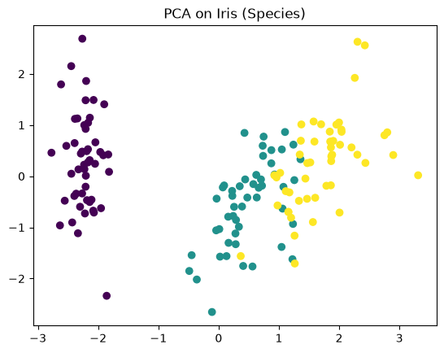
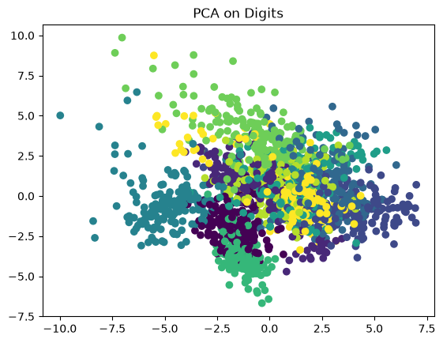
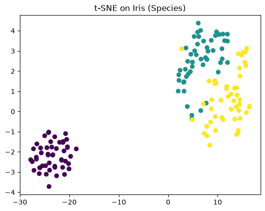
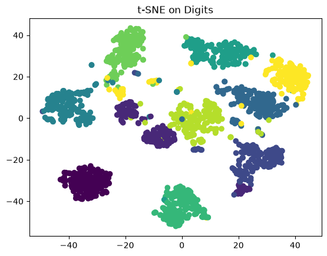
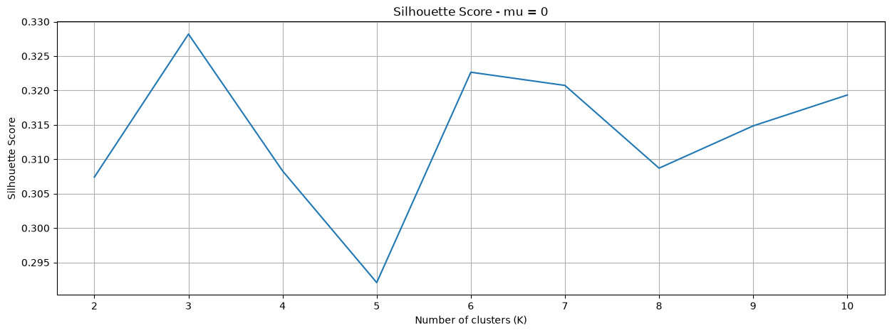
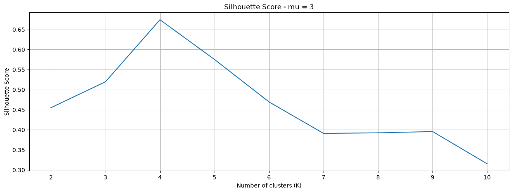
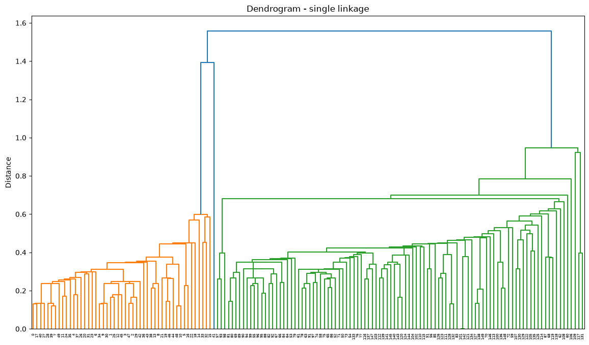
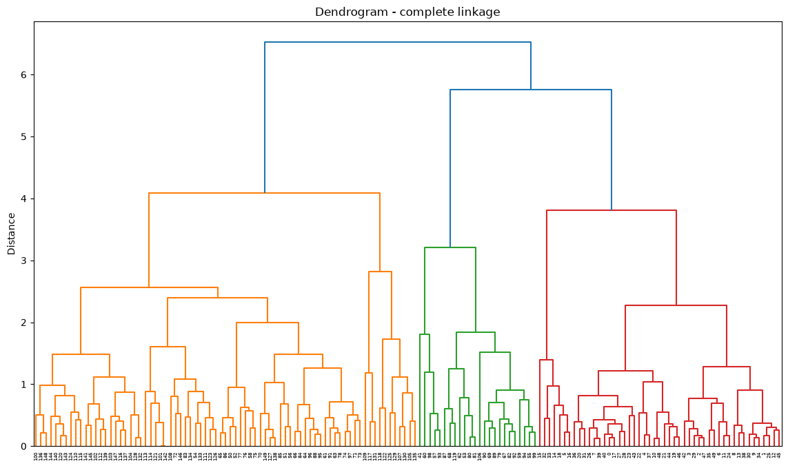
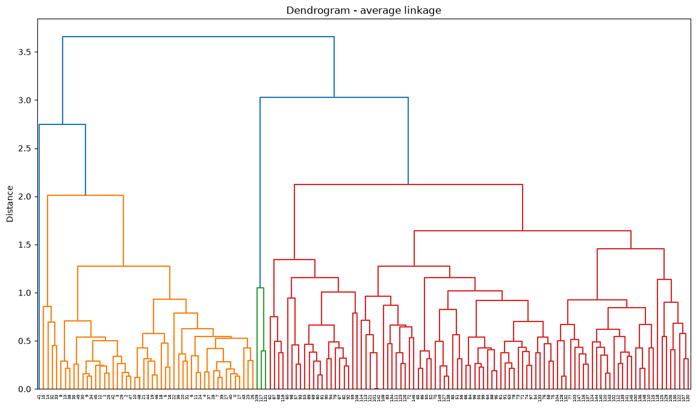
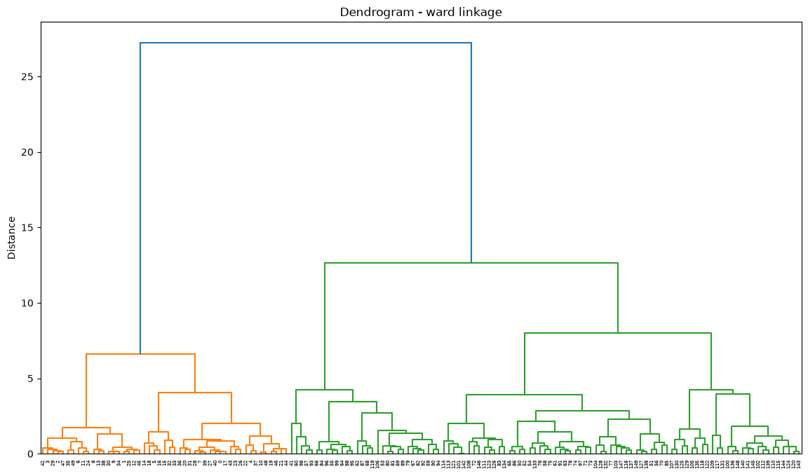

# Unsupervised Learning: Dimensionality Reduction & Clustering

A hands-on exploration of core unsupervised machine learning techniques in Python using **scikit-learn**, **SciPy** and **Matplotlib**: projecting high-dimensional data into 2D, finding the right number of clusters, and comparing hierarchical clustering strategies.

## Skills Demonstrated

- Feature standardisation with `StandardScaler`
- Dimensionality reduction with **PCA** and **t-SNE**
- **K-means** clustering and model selection with the **silhouette coefficient**
- **Agglomerative (hierarchical) clustering** with single, complete, average and Ward linkage
- Building and interpreting **dendrograms** from a scikit-learn model's linkage matrix
- Generating synthetic data from multivariate Gaussian distributions
- Visualising and interpreting results to draw conclusions

## Contents

| File | Description |
|------|-------------|
| [`unsupervised_learning_clustering.ipynb`](unsupervised_learning_clustering.ipynb) | Full notebook with code, plots and outputs |
| [`images/`](images/) | Exported figures used below |
| [`requirements.txt`](requirements.txt) | Python dependencies |

## 1. PCA vs. t-SNE

Both methods were applied to the standardised **Iris** (4 features) and **Digits** (64 features) datasets.

| PCA - Iris | PCA - Digits |
|:---:|:---:|
|  |  |
| **t-SNE - Iris** | **t-SNE - Digits** |
|  |  |

**Finding:** PCA (linear) separates the Iris species reasonably well, but the ten digit classes overlap heavily. t-SNE (non-linear, neighbourhood-preserving) produces compact, clearly separated clusters for Digits.

## 2. K-means & Silhouette Analysis

4,000 points were sampled from four Gaussians centred at (±mu, ±mu). K-means was trained for K = 2...10 on each dataset and the best K was chosen by silhouette score.

| mu | Best K | Best Silhouette |
|:--:|:------:|:---------------:|
| 0 | 3 | 0.328 |
| 1 | 3 | 0.353 |
| 2 | **4** | 0.522 |
| 3 | **4** | 0.674 |

| mu = 0 | mu = 3 |
|:---:|:---:|
|  |  |

**Finding:** when the groups overlap (mu = 0, 1) the silhouette curve is flat and low, so the selected K is not meaningful. Once the groups separate (mu = 2, 3) there is a clear peak at **K = 4**, recovering the true structure. Higher scores mean tighter, better-separated clusters.

## 3. Hierarchical Clustering - Linkage Comparison

| Single | Complete |
|:---:|:---:|
|  |  |
| **Average** | **Ward** |
|  |  |

**Finding:** single linkage shows strong *chaining* (points joined one at a time into long, unbalanced clusters). **Ward linkage** gives the healthiest result: balanced clusters with large gaps between merge distances, making the cluster structure easy to read.

## Getting Started

```bash
git clone https://github.com/DevaChaudhari/unsupervised-learning-clustering.git
cd unsupervised-learning-clustering
pip install -r requirements.txt
jupyter notebook unsupervised_learning_clustering.ipynb
```

## Tech Stack

Python · NumPy · SciPy · scikit-learn · Matplotlib · Jupyter
